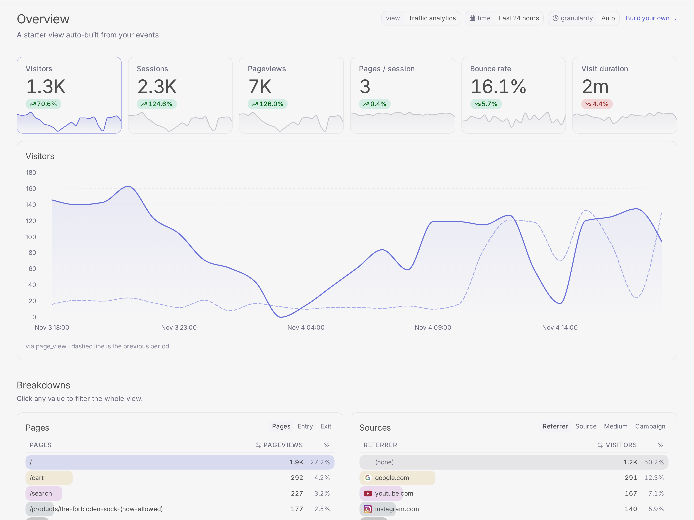
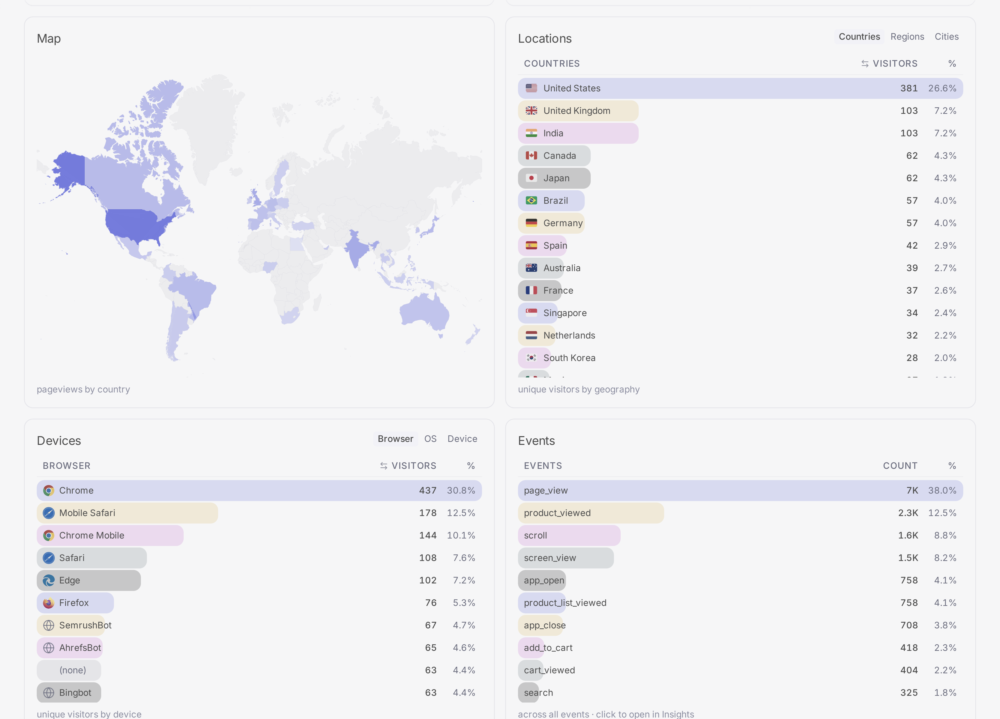
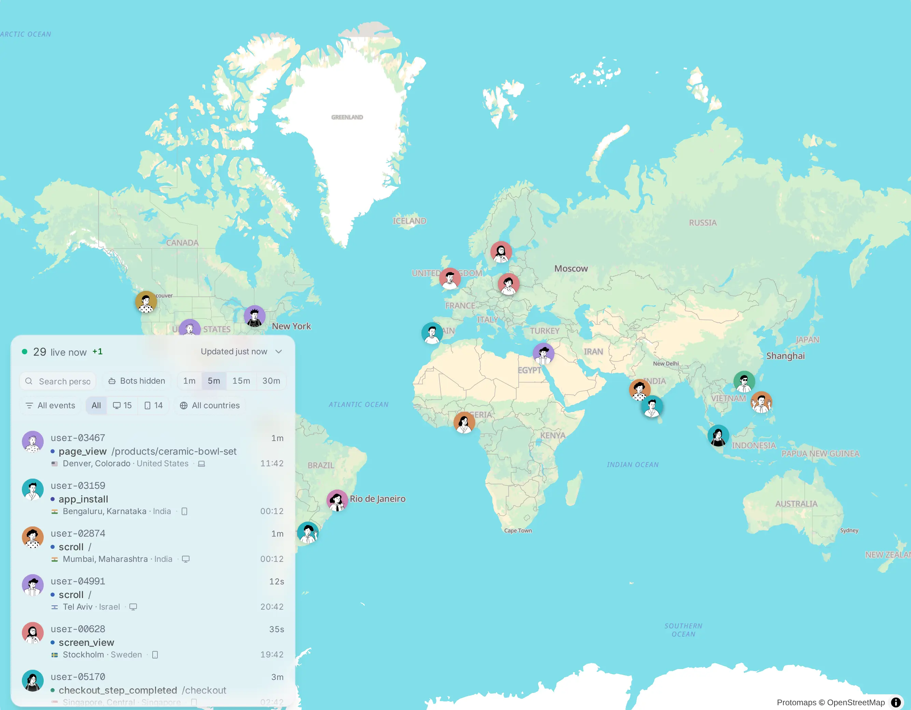
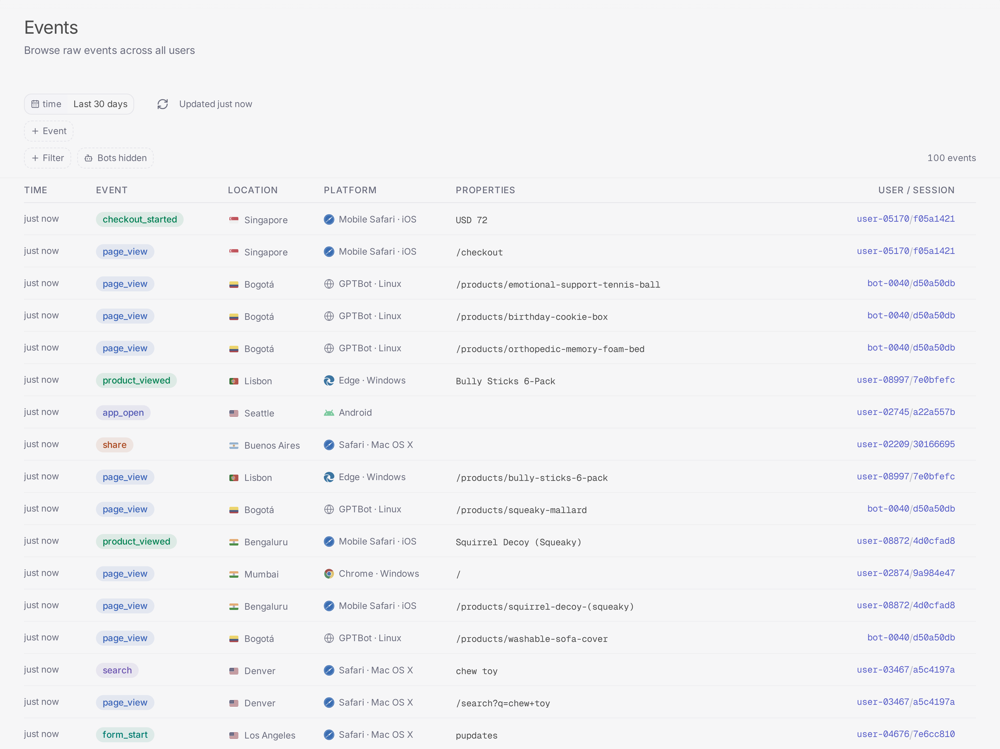
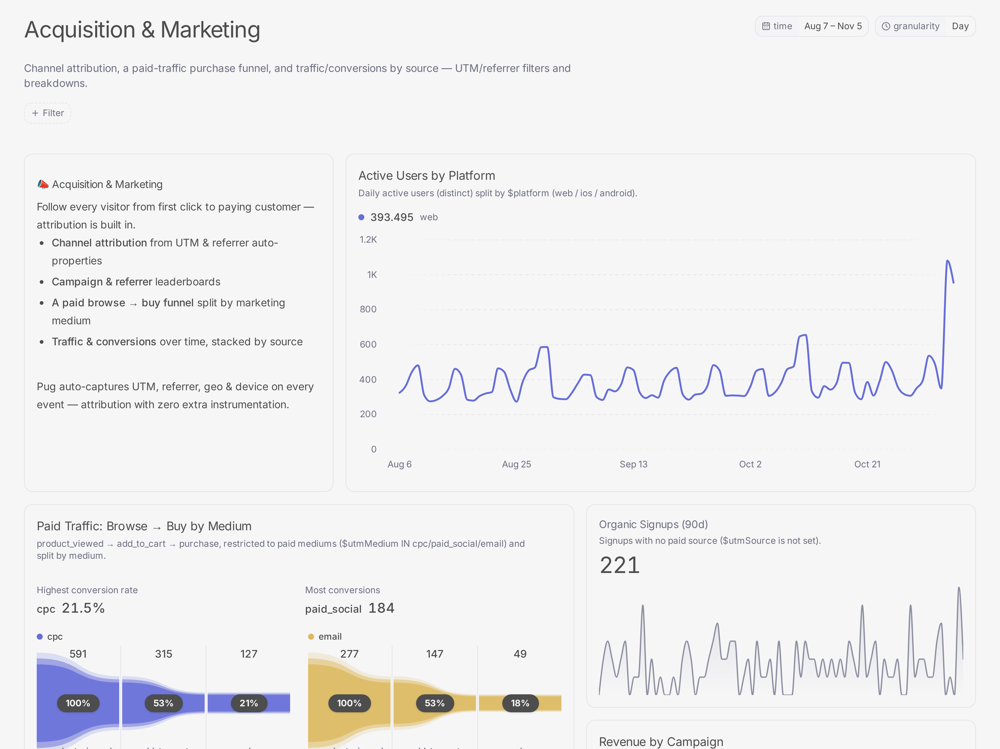
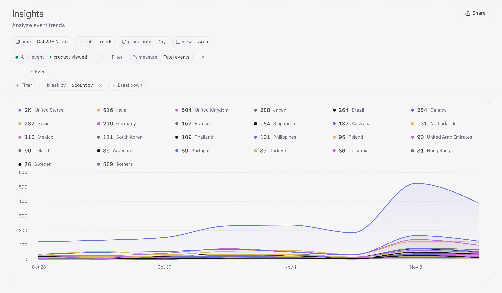
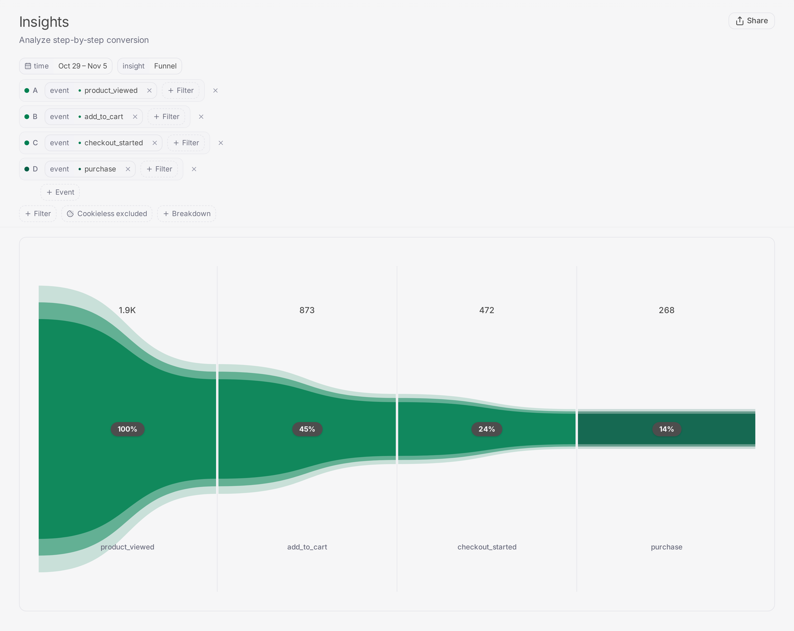
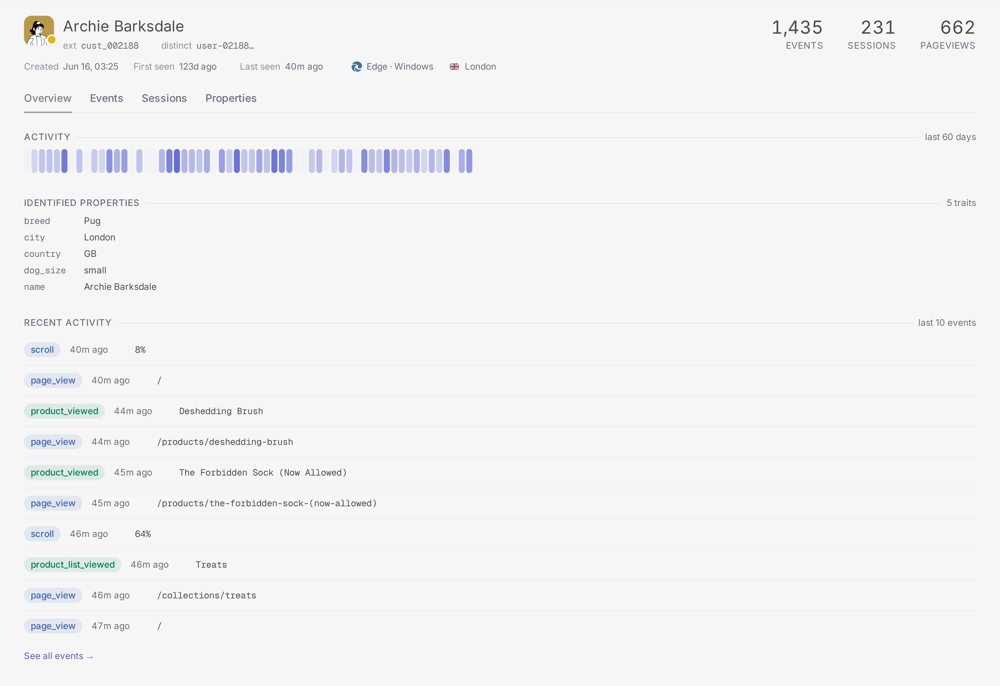

# Pug

[](https://github.com/pug-sh/pug/actions/workflows/ci.yaml)
[](https://codecov.io/gh/pug-sh/pug)
[](https://discord.gg/kDNHDWcBHP)

Pug is an open-source product analytics platform. Capture events, identify the
people behind them, and explore behavior through funnels, retention, trends,
segmentation, and user-flow analysis, all surfaced on customizable dashboards.

Built in Go on PostgreSQL, ClickHouse, and NATS.

## Features

- **Event ingestion**: a NATS-backed capture pipeline with automatic geo,
  user-agent, bot-detection, and web-attribution enrichment.
- **Web analytics**: an overview auto-built from your events: visitors,
  sessions, pageviews, bounce rate, and traffic sources, with no tile to wire up.
- **Live view**: every visitor on a real-time world map, down to the person and
  the event they just fired.
- **Profiles**: identify and alias the users behind events, with a
  ClickHouse-backed profile and activity API.
- **Insights**: trends, funnels, retention, segmentation, user flow (Sankey),
  and top-K breakdowns, with filtering, breakdowns, and period-over-period
  comparison.
- **Dashboards**: compose insight and markdown tiles on a grid with a
  board-level time window, accelerated by a pre-aggregated rollup fast path.
- **MCP server**: Claude, ChatGPT, or any MCP client can query your insights,
  events, and profiles, and build dashboards for you.
- **Privacy & compliance**: GDPR/DPDP data-subject erasure of a person's
  events and profile.

<p>
  <picture>
    <source media="(prefers-color-scheme: dark)" srcset="docs/assets/overview-dark.webp" />
    
  </picture>
  <br /><sub><b>Overview</b>: a web-analytics view auto-built from your events, with the previous period alongside.</sub>
</p>

<p>
  <picture>
    <source media="(prefers-color-scheme: dark)" srcset="docs/assets/breakdowns-dark.webp" />
    
  </picture>
  <br /><sub><b>Breakdowns</b>: pageviews by country, plus locations, devices, and events; click any value to filter the whole view.</sub>
</p>

<p>
  <picture>
    <source media="(prefers-color-scheme: dark)" srcset="docs/assets/live-dark.webp" />
    
  </picture>
  <br /><sub><b>Live view</b>: every visitor on a live world map; click one to fly to them and see the page, device, and profile behind it.</sub>
</p>

<p>
  <picture>
    <source media="(prefers-color-scheme: dark)" srcset="docs/assets/events-dark.webp" />
    
  </picture>
  <br /><sub><b>Events</b>: every raw event as it lands, with its location, platform, properties, and the person behind it.</sub>
</p>

<p>
  <picture>
    <source media="(prefers-color-scheme: dark)" srcset="docs/assets/dashboards-dark.webp" />
    
  </picture>
  <br /><sub><b>Dashboards</b>: compose insight and markdown tiles on a time-windowed grid.</sub>
</p>

<p>
  <picture>
    <source media="(prefers-color-scheme: dark)" srcset="docs/assets/insights-dark.webp" />
    
  </picture>
  <br /><sub><b>Insights</b>: trends, filters, and breakdowns; here product views split by country.</sub>
</p>

<p>
  <picture>
    <source media="(prefers-color-scheme: dark)" srcset="docs/assets/funnels-dark.webp" />
    
  </picture>
  <br /><sub><b>Funnels</b>: step-by-step conversion; here product view to purchase.</sub>
</p>

<p>
  <picture>
    <source media="(prefers-color-scheme: dark)" srcset="docs/assets/profiles-dark.webp" />
    
  </picture>
  <br /><sub><b>Profiles</b>: the person behind the events, with traits, sessions, and activity.</sub>
</p>

## MCP server

Pug serves a [Model Context Protocol](https://modelcontextprotocol.io) server,
so an AI assistant can query your analytics. Sixteen tools read projects,
dashboards, insights, events, sessions, and profiles, and one creates and edits
dashboards.

| Environment | Endpoint |
|---|---|
| Pug Cloud | `https://api.pug.sh/mcp` |
| Self-hosted | `/mcp` on your API host, e.g. `http://localhost:3000/mcp` |

In Claude, add Pug from the [connectors directory](https://claude.ai/directory/pug).
Other clients take the endpoint as a custom connector. Connect by signing in to
Pug, or with a project's private (`prv_`) API key in the `x-api-key` header. A
self-hosted server offers sign-in only once `PUG_API_BASE_URL` is set. Setup
steps for each client are in the [MCP docs](https://docs.pug.sh/mcp/).

## Tech stack

- **Go**: backend services and workers, exposed over [Connect RPC](https://connectrpc.com/) (HTTP/2)
- **PostgreSQL**: relational store (orgs, projects, dashboards, auth)
- **ClickHouse**: analytical store for events, insights, and profiles
- **NATS**: messaging backbone for the ingestion and worker pipelines

## Self-hosting

See the [self-hosting guide](https://docs.pug.sh/self-hosting/). A Pug
instance is this repo's backend, published as container images on
`ghcr.io/pug-sh`, plus the dashboard from
[`pug-sh/app`](https://github.com/pug-sh/app), served as static files.

## Quick start

```bash
# Build the binary into bin/pug
make build

# Start dev infrastructure (PostgreSQL, NATS, ClickHouse)
make infra

# Run migrations (Postgres, NATS, ClickHouse)
./bin/pug migrate

# Seed the demo project with events, profiles, and dashboards
# (resets the local Postgres and ClickHouse databases; see "Demo data" below)
./bin/pug seed

# Start the dev server + workers together
./bin/pug dev
```

[`docs/development.md`](docs/development.md) walks through each step, including
signing in as the demo org's admin.

Environment variables are documented in [`.env.example`](.env.example).
Google and generic OIDC sign-in are documented in
[`docs/authentication.md`](docs/authentication.md), with a ready-to-copy
[`config.example.json`](config.example.json).

### Demo data

`./bin/pug seed` fills a "Pug & Pals" demo project with ~6 months of history, so
dashboards, insights, and profiles have something to show. Profiles are seeded
only for users that produced events, so the data is internally consistent.

> **Local databases only.** By default `seed` migrates Postgres and ClickHouse
> all the way down and back up, dropping every table, not just the demo rows.
> There is no confirmation prompt and no environment check: it connects to
> whatever `DATABASE_URL` and `CLICKHOUSE_URL` resolve to, and an already
> exported variable beats `.env`. Point it at a disposable local or demo
> database.

Pass `--no-reset` to keep the schema; it then deletes the demo project's own
events and profiles before re-seeding them, leaving other projects untouched.
Volume is tunable with `--count` (default 500,000 events) and `--batch` (default
10,000 events per insert). Run it from the repo root; it reads the same `.env`
as the rest of the CLI.

Two read-only accounts are seeded, plus an admin if you ask for one:

- `woof@pug.sh` owns the demo org and its data. It has no password.
- `snoop@pug.sh` is a viewer with no password; open `/demo` with
  `PUG_DEMO_ENABLED=true` to sign in as it.
- `admin@pug.example` is the demo org's admin, seeded only when
  `PUG_DEMO_ADMIN_PASSWORD` is set (16 characters to 72 bytes, no surrounding
  whitespace), with that password. The address can't receive mail. Nothing logs
  the password, and later runs never change it, so change it in the dashboard,
  to 16 characters or more, and update the variable to match, since the seeder
  restores the admin's role only while they match. A default `pug seed` resets
  the database, though, and so recreates the admin from the current value.

For a live stream of traffic instead of a one-shot backfill, set
`PUG_DEMO_ENABLED=true`: `./bin/pug dev` then also runs the demo worker. It
backfills an **empty** project once, so after `pug seed` it skips straight to
playing new sessions out in real time. If you seed with a smaller `--count`,
lower `PUG_DEMO_SEED_COUNT` to match: the worker reads a project holding fewer
events than that as an interrupted backfill and warns rather than topping it up.

## Development

```bash
make test    # run tests (race detector enabled)
make cover   # run tests and write coverage.out
make lint    # lint Go code
make sqlc    # regenerate sqlc queries after editing SQL
make rpc     # regenerate protobuf code after editing .proto files
make templ   # regenerate templ email templates
```

## Architecture

Per-subsystem documentation lives in [`docs/architecture/`](docs/architecture/)
(insights, ClickHouse, profiles, ingestion, email, telemetry). Contributor
guidance and conventions are in [`CLAUDE.md`](CLAUDE.md).

## License

Copyright (C) 2025 pug.sh contributors.

Pug is licensed under the [GNU AGPL v3.0](LICENSE), or (at your option) any
later version. Contributors sign a [CLA](CLA.md) before their first pull
request is merged; see [CONTRIBUTING.md](CONTRIBUTING.md).
